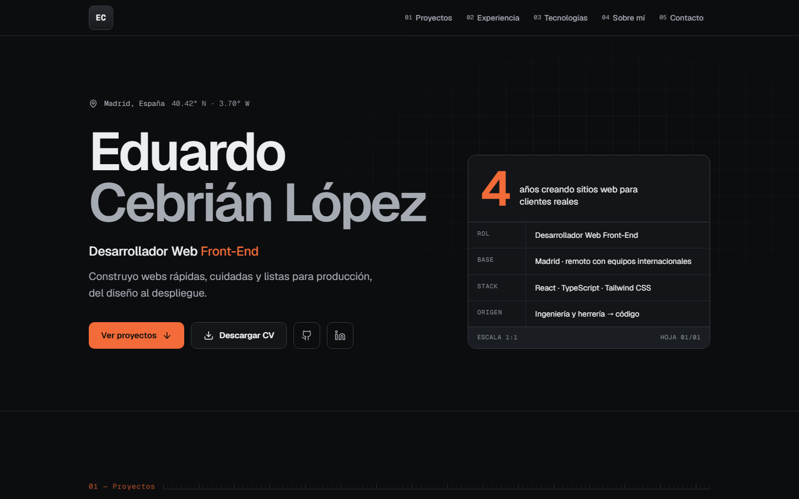

# Portafolio · Eduardo Cebrián López

Portafolio personal de **Eduardo Cebrián López**, desarrollador web front-end en Madrid.
Una sola página con proyectos en producción, experiencia, tecnologías, trayectoria y contacto,
inspirada en la estética de los planos técnicos: cuadrícula de fondo, reglas graduadas y un
cajetín con la ficha técnica.

**Web publicada:** <https://eduardocebrian.dev>



## Stack

- [Vite](https://vite.dev) + [React 19](https://react.dev) + [TypeScript](https://www.typescriptlang.org) en modo `strict`
- [Tailwind CSS 4](https://tailwindcss.com): los colores del diseño son tokens del tema (`bg-bg`, `text-mu`, `border-line2`, `text-accent`…)
- Fuentes Geist y Geist Mono autoalojadas con [Fontsource](https://fontsource.org)
- Sin librerías de UI ni de animación: iconos SVG propios y animaciones con CSS
- ESLint (`typescript-eslint` estricto, `jsx-a11y`, `react-hooks`) y Prettier con ordenación de clases de Tailwind
- Despliegue en [Netlify](https://www.netlify.com)

### Detalles técnicos

- **Contenido en datos tipados**: todos los textos, proyectos, experiencia, tecnologías y enlaces viven en `src/data/`. Los componentes solo pintan.
- **Animaciones**: entrada escalonada del hero y aparición de secciones al hacer scroll con `animation-timeline: view()`. En navegadores sin soporte (Safari, Firefox) un `IntersectionObserver` hace lo mismo. Todo se desactiva con `prefers-reduced-motion`.
- **Navegación**: marca la sección visible (`aria-current`) y, en móvil, centra el enlace activo en la barra desplazable.
- **Accesibilidad**: HTML semántico, un solo `h1`, secciones etiquetadas con `aria-labelledby`, enlace para saltar al contenido, foco visible y aviso de «se abre en una pestaña nueva» en los enlaces externos.
- **Lighthouse**: 97–100 en rendimiento y 100 en accesibilidad, buenas prácticas y SEO.

## Estructura

```
├── public/                    Archivos estáticos: favicon, imagen Open Graph, CV, robots.txt
├── capturas/                  Capturas originales sin optimizar (no se suben a Git)
├── scripts/
│   ├── generate-brand-assets.mjs   Genera favicon e imagen Open Graph (npm run brand)
│   └── optimize-screenshots.mjs    Convierte capturas a WebP (npm run screenshots)
├── src/
│   ├── assets/projects/       Capturas de proyectos en WebP (<id>.webp)
│   ├── components/
│   │   ├── layout/            Nav, Footer
│   │   ├── sections/          Hero, TechSheet, Projects, ProjectCard, ProjectMedia,
│   │   │                      Experience, Tech, About, Contact
│   │   └── ui/                Button, IconButton, Section, SectionHeader, SectionLabel, Tag, icons
│   ├── data/                  Contenido de la web
│   │   ├── links.ts           Todos los enlaces personales y de proyectos
│   │   ├── projects.ts        Proyectos
│   │   ├── experience.ts      Línea de tiempo
│   │   ├── tech.ts            Tecnologías agrupadas
│   │   ├── profile.ts         Hero, ficha técnica y «Sobre mí»
│   │   ├── sections.ts        Secciones: navegación, títulos y subtítulos
│   │   ├── site.ts            URL de producción
│   │   └── types.ts           Tipos del contenido
│   ├── hooks/                 useActiveSection, useScrollReveal
│   ├── lib/                   Utilidades (clases, enlaces externos, capturas, formato)
│   ├── App.tsx
│   ├── index.css              Tema de Tailwind, utilidades del diseño y animaciones
│   └── main.tsx
├── index.html                 Metaetiquetas SEO, Open Graph y Twitter
└── netlify.toml               Configuración de despliegue
```

## Cómo añadir un proyecto

1. Abre `src/data/projects.ts` y añade un objeto a la lista `PROJECTS`:

   ```ts
   {
     id: 'mi-proyecto',               // también es el nombre de su captura
     category: 'Web corporativa',
     title: 'Mi proyecto',
     description: 'Qué es y qué problema resuelve.',
     role: 'diseño y desarrollo',
     tags: ['React', 'TypeScript'],
     span: 6,                         // columnas en escritorio: 4, 6, 8 o 12
     links: LINKS.projects.miProyecto,
     screenshot: {
       alt: 'Descripción de lo que se ve en la captura.',
       placeholder: 'Captura · Mi proyecto',
     },
   },
   ```

2. Añade sus enlaces en `src/data/links.ts`, dentro de `projects`. Un enlace escrito entre
   corchetes (`'[ENLACE AL REPOSITORIO]'`) se considera pendiente y su botón no se muestra.
3. Para la captura, guarda la imagen como `capturas/mi-proyecto.png` y ejecuta
   `npm run screenshots`. Se crea `src/assets/projects/mi-proyecto.webp` (16:10) y la tarjeta
   la muestra sola. Mientras no exista, se ve el placeholder con rejilla.

El código `P/01`, `P/02`… se calcula según el orden de la lista. Para que las filas queden
completas, procura que los `span` de cada fila sumen 12.

## Ejecutar en local

Requisitos: Node.js 20.19 o superior.

```bash
npm install
npm run dev
```

Otros comandos:

| Comando               | Qué hace                                     |
| --------------------- | -------------------------------------------- |
| `npm run build`       | Comprueba tipos y genera la web en `dist/`   |
| `npm run preview`     | Sirve el build de producción en local        |
| `npm run lint`        | Ejecuta ESLint                               |
| `npm run format`      | Formatea el código con Prettier              |
| `npm run screenshots` | Convierte las capturas de `capturas/` a WebP |
| `npm run brand`       | Regenera el favicon y la imagen Open Graph   |

## Despliegue

La web se despliega en Netlify desde la rama `main` con la configuración de `netlify.toml`
(`npm run build`, carpeta `dist`). Si cambia el dominio, actualiza `SITE_URL` en
`src/data/site.ts`: se usa en las etiquetas canonical, Open Graph y Twitter.
